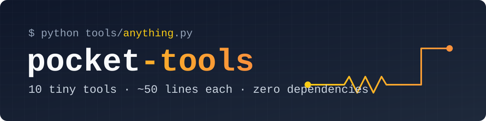

<p align="center">
  
</p>

<p align="center">
  <a href="https://github.com/nguyenminhtriet25052008-hub/pocket-tools/actions/workflows/ci.yml"></a>
  
  
  
  <a href="LICENSE"></a>
</p>

<p align="center">
  <b>Tiny, zero-dependency Python tools (~50 lines each) that you'll actually use.</b><br>
  No <code>pip install</code>. No frameworks. Copy one file and run it.
</p>

---

## ✨ The tools

| Tool | What it does | Try it |
|------|--------------|--------|
| 🧬 [`dupfind`](tools/dupfind.py) | Find duplicate files fast (size → partial hash → full hash) | `python tools/dupfind.py ~/Pictures` |
| 📦 [`bigfiles`](tools/bigfiles.py) | Show the largest files or folders eating your disk | `python tools/bigfiles.py C:/ -n 20` |
| 🗂️ [`organize`](tools/organize.py) | Sort a messy folder (Downloads!) into Images/Docs/Videos/… | `python tools/organize.py ~/Downloads` |
| ✏️ [`bulkrename`](tools/bulkrename.py) | Regex bulk rename with preview, counters & conflict check | `python tools/bulkrename.py "IMG_(\d+)" "trip_\1"` |
| 📱 [`lanshare`](tools/lanshare.py) | Share a folder over Wi-Fi: phone ⇄ PC download **and upload** | `python tools/lanshare.py .` |
| 🔐 [`pwgen`](tools/pwgen.py) | Cryptographically secure passwords & passphrases | `python tools/pwgen.py --words 5` |
| 🍅 [`pomodoro`](tools/pomodoro.py) | Focus timer in the terminal with a progress bar & beep | `python tools/pomodoro.py 25 5` |
| 🔁 [`watchrun`](tools/watchrun.py) | Re-run any command when files change | `python tools/watchrun.py "*.py" -- python -m unittest` |
| ⚡ [`resistor`](tools/resistor.py) | Resistor color code ⇄ value, plus Ohm's law solver | `python tools/resistor.py 4.7k` |
| 🔎 [`jsonq`](tools/jsonq.py) | A tiny `jq`: pretty-print / query JSON with `a.b[0].c` paths | `python tools/jsonq.py data.json "users[*].name"` |

## 🚀 Quick start

```bash
git clone https://github.com/nguyenminhtriet25052008-hub/pocket-tools.git
cd pocket-tools
python tools/resistor.py brown black red gold
```

Or just grab a single file: open it on GitHub → **Download raw file** → `python thatfile.py --help`.
Every tool has `--help`. Anything that moves or renames files **only previews** until you add `--apply`.

> 💡 **Tip:** add the `tools/` folder to your `PATH` (or make aliases) and use them like built-in commands.

## 🎬 Demos

<details open>
<summary><b>⚡ resistor</b>: never look up the color chart again</summary>

```console
$ python tools/resistor.py brown black red gold
1 kOhm  +/-5%   (range 950 Ohm .. 1.05 kOhm)

$ python tools/resistor.py 4.7k
yellow violet red gold

$ python tools/resistor.py 220 -b 5
red red black black brown

$ python tools/resistor.py --ohm V=12 R=470
V = 12 V   I = 25.53 mA   R = 470 Ohm   P = 306.4 mW
```
</details>

<details open>
<summary><b>📱 lanshare</b>: move files between phone and PC without cables or apps</summary>

```console
$ python tools/lanshare.py D:/Shared
Sharing D:\Shared
Open on your phone: http://192.168.1.23:8000
Ctrl+C to stop.
```
Open the link in your phone's browser to download files, or pick files and tap **Upload**.
⚠️ Use only on networks you trust: anyone on the same Wi-Fi can access the folder while it runs.
</details>

<details>
<summary><b>🧬 dupfind</b></summary>

```console
$ python tools/dupfind.py ~/Pictures --min-size 100K

[3 copies x 4,812,330 bytes]
  /home/me/Pictures/IMG_2041.jpg
  /home/me/Pictures/backup/IMG_2041.jpg
  /home/me/Pictures/old/copy of IMG_2041.jpg

12 duplicate groups, 87.40 MB reclaimable.
```
</details>

<details>
<summary><b>🗂️ organize</b></summary>

```console
$ python tools/organize.py ~/Downloads
photo.jpg  ->  Images/photo.jpg
report.pdf  ->  Documents/report.pdf
song.mp3  ->  Audio/song.mp3

3 files would be moved (dry-run, use --apply).
```
</details>

<details>
<summary><b>✏️ bulkrename</b></summary>

```console
$ python tools/bulkrename.py "(.*)\.png$" "slide_{n:02}.png"
cover.png  ->  slide_01.png
intro.png  ->  slide_02.png

2 files to rename (preview, use --apply).
```
`\1 \2` = regex groups, `{n}` / `{n:03}` = counter. Conflicts are detected before anything is touched.
</details>

<details>
<summary><b>🔐 pwgen</b></summary>

```console
$ python tools/pwgen.py -c 3
n!wU?w8+9ghB@bosbVM?
YA9WkV9NGhu@3?nXWs9o
_DbsqmIs3aG_LeJ708-E

~125 bits of entropy each

$ python tools/pwgen.py --words 5
leaf-body-base-cube-drum
```
</details>

<details>
<summary><b>🔎 jsonq</b></summary>

```console
$ curl -s https://api.github.com/repos/python/cpython | python tools/jsonq.py - stargazers_count
$ python tools/jsonq.py users.json "users[*].email"
[
  "an@x.io",
  "binh@x.io"
]
```
</details>

<details>
<summary><b>📦 bigfiles · 🍅 pomodoro · 🔁 watchrun</b></summary>

```console
$ python tools/bigfiles.py ~ --dirs -n 3
Total: 182.4 GB in 412,007 files

    182.4 GB  /home/me
     61.0 GB  /home/me/Videos
     23.7 GB  /home/me/.cache

$ python tools/pomodoro.py 25 5
Round 1/4
WORK   [##########--------------------] 16:40

$ python tools/watchrun.py "src/**/*.c" -- make
Watching 14 files. Ctrl+C to stop.
```
</details>

## 🤔 Why?

Because most everyday tasks don't deserve a 200 MB dependency tree. Each tool here is:

- **Readable in 2 minutes.** Learn from it, tweak it, make it yours.
- **Portable.** Python 3.8+ and nothing else. Works on Windows, macOS and Linux (tested in CI).
- **Safe by default.** Destructive actions preview first.

## 🧪 Tests

```bash
python -m unittest discover -s tests -v
```

## 🤝 Contributing

Got a tiny tool idea? Open an [issue](../../issues/new/choose) or read [CONTRIBUTING.md](CONTRIBUTING.md).
If this saved you some time, a ⭐ makes my day!

---

## 🇻🇳 Tiếng Việt

**pocket-tools** là bộ công cụ Python siêu nhỏ (mỗi tool khoảng 50 dòng), **không cần cài thêm thư viện**, giải quyết những việc vặt hằng ngày:

- 🧬 **dupfind**: tìm file trùng để dọn ổ cứng
- 📦 **bigfiles**: xem file hay thư mục nào chiếm nhiều dung lượng nhất
- 🗂️ **organize**: tự xếp thư mục Downloads theo loại file
- ✏️ **bulkrename**: đổi tên hàng loạt bằng regex, xem trước rồi mới áp dụng
- 📱 **lanshare**: chuyển file giữa điện thoại và máy tính qua WiFi, không cần cáp hay app
- 🔐 **pwgen**: tạo mật khẩu an toàn
- 🍅 **pomodoro**: đồng hồ học tập Pomodoro ngay trong terminal
- 🔁 **watchrun**: tự chạy lại lệnh mỗi khi file thay đổi
- ⚡ **resistor**: đọc vạch màu điện trở và tính định luật Ohm, dành cho sinh viên Điện - Điện tử
- 🔎 **jsonq**: xem và truy vấn file JSON

Cách dùng: cài Python 3.8 trở lên rồi chạy `python tools/<tên_tool>.py --help`.
Repo được viết bởi một sinh viên Điện - Điện tử, Đại học Bách Khoa TP.HCM. Mọi đóng góp đều được hoan nghênh! 💛

## 📄 License

[MIT](LICENSE) © 2026 Nguyen Minh Triet
